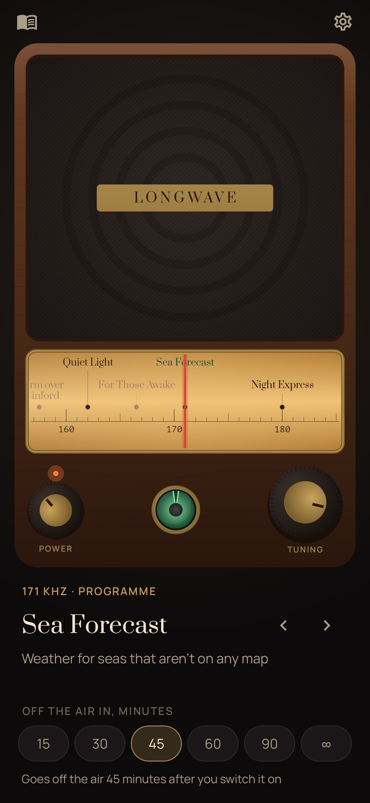
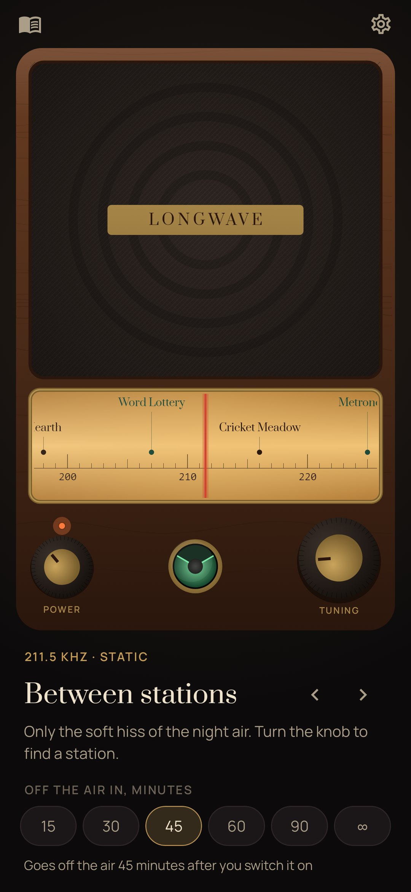
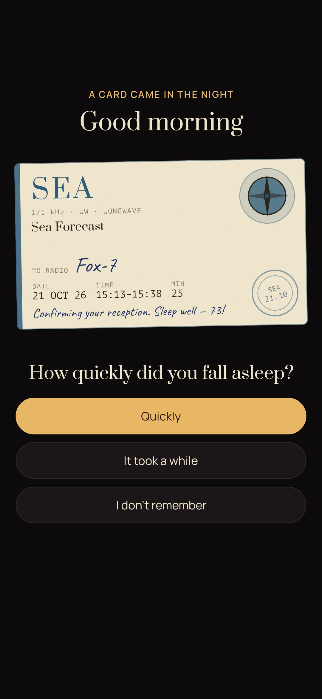
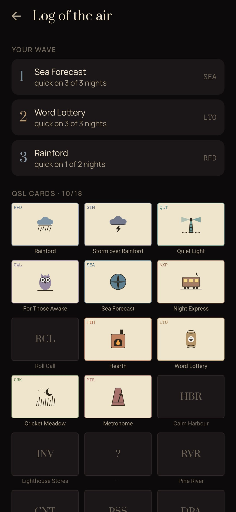

<div align="center">


# Longwave

### A valve radio for falling asleep.

*An old long-wave set on the nightstand. Turn the knob and find a station that isn't on any map: rain over Rainford, the sea under a lighthouse, a night train, a stove. Some stations talk, slowly and dull on purpose, using real ways to quiet the mind. Set when it goes off the air, and at the end the station drifts away into the static and the static goes quiet. The morning after, the station sends you a QSL card. Free, no ads, no account, no internet permission.*

[](https://github.com/bigdevwhale/longwave/actions/workflows/android.yml)
[](https://github.com/bigdevwhale/longwave/releases/latest)


[](LICENSE)

**English** · [Русский](README.ru.md) · [Changelog](CHANGELOG.md)

   

</div>

---

## How a night goes

1. **Warm up the valves.** Press the power knob. The dial lights amber and the green tuning eye comes on.
2. **Find a station.** Drag the dial or the big knob. Between stations you hear the hiss and crackle of the night air, and a whistle just off a station. On a station the eye closes and the sound comes clear. You can tune with your eyes closed: the phone ticks for every kilohertz and knocks once on a station.
3. **Pick when it goes off the air:** 15 to 90 minutes, or never.
4. **Fall asleep.** In the last minutes the needle drifts off the station, the static rises, then everything goes quiet. If you touch the screen during this, you're still awake, so the radio stays on another 15 minutes.
5. **In the morning** the station sends a QSL card, the postcard real stations send to listeners who heard them. It's addressed to your call sign, with the date, the time and the minutes. One question goes with it: did you fall asleep quickly?

## The stations

| | |
|---|---|
| 🌧 **Sounds** | Rainford (rain) · Quiet Light (the sea under a lighthouse) · Night Express (a sleeper train) · Hearth (a stove) · Cricket Meadow · Calm Harbour (a boat at the pier) · Pine River · High Pass (wind) · Deep Air (brown noise) |
| 🗣 **Programmes** | **Sea Forecast**: weather for seas that aren't on any map, read like the BBC Shipping Forecast and never the same twice · **Roll Call**: a body scan, each part called and answering by growing heavy · **Word Lottery**: cognitive shuffle, random words to picture, one by one · **Metronome**: 4-7-8 breathing to high, soft and low ticks, then slower and slower · **Lighthouse Stores**: an inventory read very slowly · **Countdown**: from a hundred down, quieter each time |
| ✨ **Rare stations** | **Storm over Rainford** comes on about one night in five. **For Those Awake** broadcasts between 1:30 and 4:30 a.m., with kind words for people who can't sleep and no pressure to. **Moon Station** plays a music box for three nights around the full moon. On the dial they're a question mark until you find them. |

## The log of the air

- **Your wave:** after a few answered mornings, the stations you fall asleep to fastest.
- **QSL cards:** an album with one slot per station, 18 in all, each with its own emblem.
- **Nights:** every night the radio played you to sleep.

## Inside

- One `AudioTrack` mixes the station, the static (pink hiss, far-thunder crackles, a heterodyne whistle off tune) and long-wave fading, all following the needle (`audio/Engine.kt`). Brown noise, the valve hum, the metronome and the music box are synthesised. The other sounds are field recordings.
- The voices are recorded ahead of time by `tools/narrate.py` with open neural voices: [Silero](https://github.com/snakers4/silero-models) for Russian and [Kokoro-82M](https://huggingface.co/hexgrad/Kokoro-82M) for English. There are two of them, a soft night voice and a lower announcer. The voice sinks into the static with the station when you tune away.
- The radio plays as a media foreground service, so it keeps going with the screen off. It steps aside for calls.
- The cabinet, the dial, the magic eye, the knobs and the 18 QSL emblems are all drawn in code.

## Privacy

No account, no cloud, no analytics and no internet permission. The log lives in the app's own database.

## Building

```
./gradlew assembleDebug                      # app.longwave.dev
./gradlew assembleDebug -Pdemo               # app.longwave.demo: a month of nights and a card waiting
./gradlew testDebugUnitTest -Prender         # screens and cards drawn to app/build/art
python tools/shots.py                        # renders → docs/screenshots
```

## Sound credits

The field recordings are from Freesound and SoundBible, as edited for [Blanket](https://github.com/rafaelmardojai/blanket). Full list in [CREDITS.md](CREDITS.md).

Longwave is for rest and sleep. It is not a medical treatment.

## License

MIT
