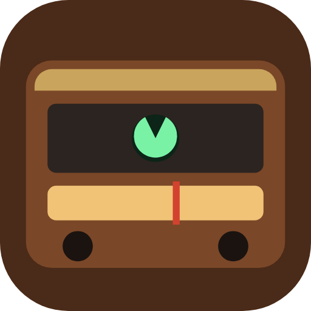
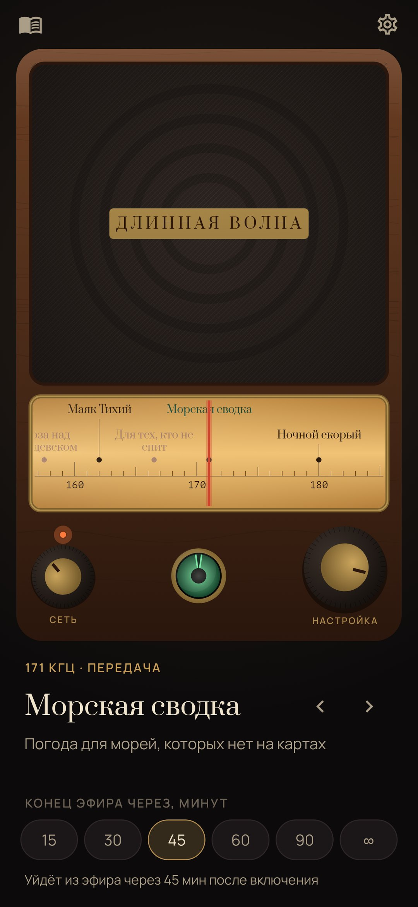
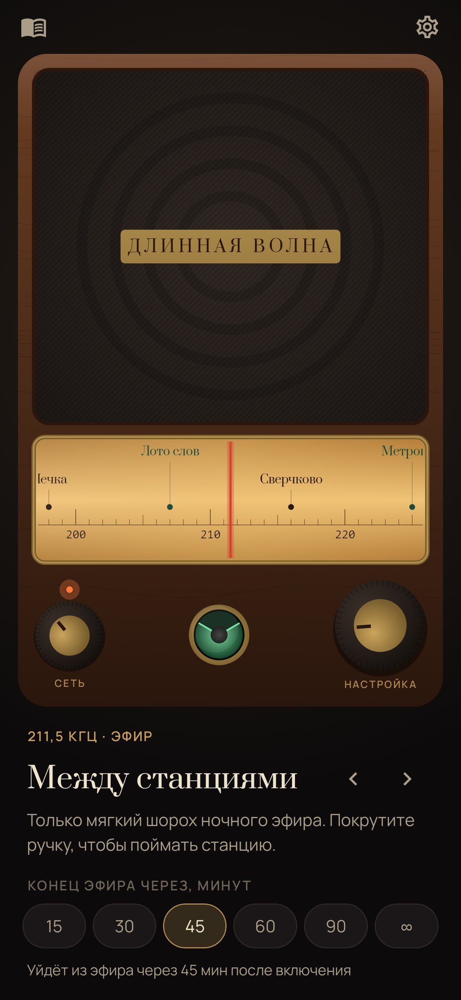
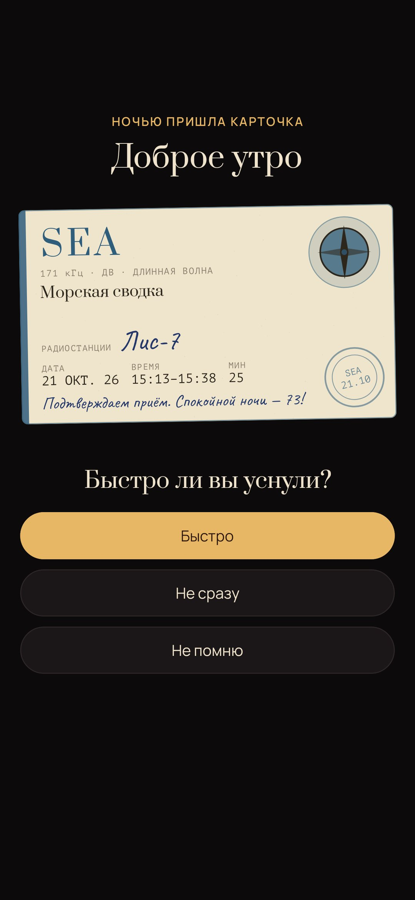
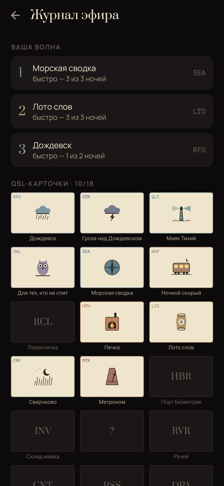

<div align="center">



# Длинная волна

### Ламповый приёмник, под который засыпают.

*Старый длинноволновый приёмник на тумбочке. Покрутите ручку и поймайте станцию, которой нет на картах: дождь над Дождевском, море под маяком, ночной поезд, печку. Некоторые станции говорят, медленно и нарочно скучно, и в основе у них настоящие способы успокоить ум. Выберите, когда закончится эфир: в конце станция уплывёт в шум, а шум затихнет. Утром станция пришлёт вам QSL-карточку. Бесплатно, без рекламы, без аккаунта, без доступа в интернет.*

[](https://github.com/bigdevwhale/longwave/actions/workflows/android.yml)
[](https://github.com/bigdevwhale/longwave/releases/latest)


[](LICENSE)

[English](README.md) · **Русский** · [Изменения](CHANGELOG.md)

   

</div>

---

## Как проходит ночь

1. **Прогрейте лампы.** Нажмите ручку «Сеть». Шкала засветится янтарём, и загорится зелёный глаз настройки.
2. **Поймайте станцию.** Ведите шкалу или большую ручку. Между станциями шуршит и потрескивает ночной эфир, рядом со станцией слышен свист. На станции глаз сужается, и звук становится чистым. Настраиваться можно с закрытыми глазами: на каждый килогерц телефон щёлкает, на станции даёт короткий толчок.
3. **Выберите, когда закончится эфир:** через 15–90 минут или никогда.
4. **Засыпайте.** В последние минуты стрелка уплывает со станции, нарастает шум, потом всё затихает. Если в это время коснуться экрана, значит, вы ещё не спите, и радио поиграет ещё 15 минут.
5. **Утром** станция пришлёт QSL-карточку. Такие открытки настоящие станции присылают слушателям, которые их поймали. На ней ваш позывной, дата, время и минуты эфира, а к ней один вопрос: быстро ли вы уснули?

## Станции

| | |
|---|---|
| 🌧 **Звуки** | Дождевск (дождь) · Маяк Тихий (море под маяком) · Ночной скорый (спальный вагон) · Печка · Сверчково · Порт Безветрие (лодка у причала) · Ручей · Перевал (ветер) · Глубокий эфир (коричневый шум) |
| 🗣 **Передачи** | **Морская сводка**: погода для морей, которых нет на картах, в манере BBC Shipping Forecast и каждый раз новая · **Перекличка**: сканирование тела, каждая часть отзывается тяжестью · **Лото слов**: когнитивное перемешивание, случайные слова по одному, представляйте каждое · **Метроном**: дыхание 4-7-8 под высокие, тихие и низкие щелчки, потом всё медленнее · **Склад маяка**: опись, прочитанная очень медленно · **Отсчёт**: от ста вниз, с каждым числом тише |
| ✨ **Редкие станции** | **Гроза над Дождевском** выходит в эфир примерно раз в пять ночей. **Для тех, кто не спит** вещает с 1:30 до 4:30: добрые слова тем, кому не спится, и никакого давления. **Лунная** играет музыкальную шкатулку три ночи вокруг полнолуния. Пока станцию не поймали, на шкале она отмечена вопросом. |

## Журнал эфира

- **Ваша волна:** после нескольких утренних ответов здесь видно, под какие станции вы засыпаете быстрее всего.
- **QSL-карточки:** альбом из 18 мест, по одному на станцию, у каждой своя эмблема.
- **Ночи:** все ночи, когда радио уложило вас спать.

## Внутри

- Один `AudioTrack` смешивает станцию, эфирный шум (розовое шипение, треск дальних гроз, свист рядом со станцией) и замирания дальнего приёма, и всё это следует за стрелкой (`audio/Engine.kt`). Коричневый шум, гул ламп, метроном и шкатулка синтезируются, остальное — полевые записи.
- Голоса записаны заранее скриптом `tools/narrate.py` открытыми нейросетевыми голосами: [Silero](https://github.com/snakers4/silero-models) для русского и [Kokoro-82M](https://huggingface.co/hexgrad/Kokoro-82M) для английского. Их два: мягкий ночной и диктор пониже. Когда уводишь стрелку, голос тонет в шуме вместе со станцией.
- Радио играет как медиа-сервис переднего плана, поэтому не замолкает при выключенном экране. На время звонка оно уступает.
- Корпус, шкала, «магический глаз», ручки и 18 эмблем на карточках нарисованы в коде.

## Приватность

Без аккаунта, облака, аналитики и доступа в интернет. Журнал хранится в собственной базе приложения.

## Сборка

```
./gradlew assembleDebug                      # app.longwave.dev
./gradlew assembleDebug -Pdemo               # app.longwave.demo: месяц ночей и карточка, ждущая утра
./gradlew testDebugUnitTest -Prender         # экраны и карточки в app/build/art
python tools/shots.py                        # рендеры → docs/screenshots
```

## Звуки

Полевые записи взяты с Freesound и SoundBible в обработке проекта [Blanket](https://github.com/rafaelmardojai/blanket). Полный список в [CREDITS.md](CREDITS.md).

«Длинная волна» — для отдыха и сна. Это не лечение.

## Лицензия

MIT
